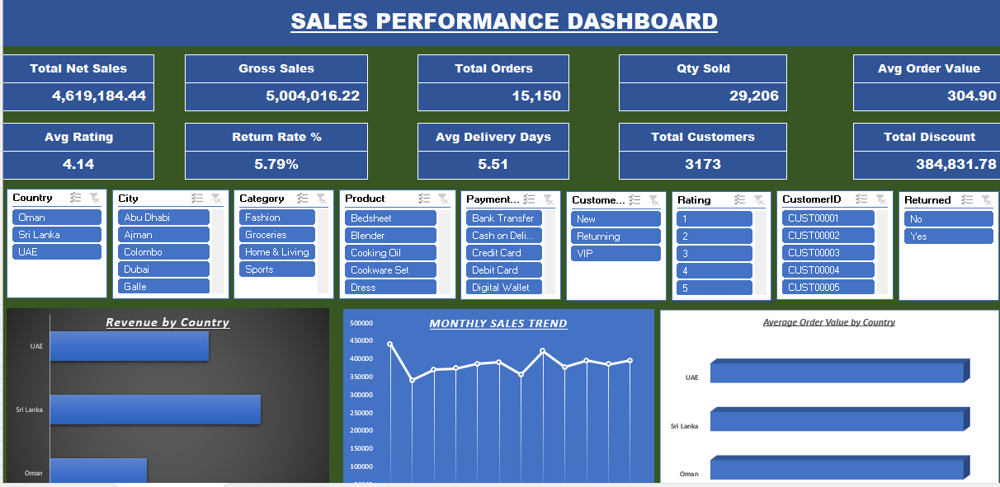

# GlobalMart Sales Dashboard

An interactive sales dashboard built in Microsoft Excel using PivotTables, PivotCharts, slicers, and data-cleaning workflows. It explores a simulated e-commerce dataset spanning Sri Lanka, the UAE, and Oman.



## Project overview

The goal is to turn transaction-level data into a clear, decision-ready view of business performance for regional managers and other stakeholders.

| Item | Details |
|---|---|
| Project type | Excel data analysis and dashboard |
| Dataset | Simulated e-commerce transactions |
| Records | 15,150+ transactions (as documented for this project) |
| Regions | Sri Lanka, UAE, Oman |
| Tools | Microsoft Excel, PivotTables, PivotCharts, slicers, Power Query |

## Project files

- [Excel dashboard and cleaned data](workbook/GlobalMart_Sales_Dashboard_and_Cleaned_Data.xlsx)
- [Raw dataset](data/raw/globalmart_dataset_raw.csv)
- [Dashboard preview](screenshots/dashboard-preview.png)
- [Additional dashboard screenshots](screenshots/dashboards/)
- [Data-cleaning screenshots](screenshots/data-cleaning/)
- [Analysis and KPI screenshots](screenshots/insights/)
- [Project structure guide](docs/project-structure.md)
- [Data dictionary](docs/data-dictionary.md)
- [Analysis notes template](docs/analysis-notes.md)

## Dashboard capabilities

- Summarizes sales by region, product category, and time period.
- Uses charts to communicate performance patterns and comparisons.
- Uses slicers for interactive filtering.
- Presents key metrics in an executive-style dashboard.

## Analysis workflow

1. Inspect the source transaction data and understand the fields.
2. Clean and standardize dates, values, and categories.
3. Create and validate calculated fields such as revenue.
4. Build PivotTables to summarize measures and dimensions.
5. Create PivotCharts and add slicers for interactive exploration.
6. Validate totals and document findings that are supported by the workbook.

## Repository layout

```text
globalmart-excel-sales-dashboard/
├── README.md
├── .gitignore
├── data/
│   └── raw/
│       └── globalmart_dataset_raw.csv
├── workbook/
│   └── GlobalMart_Sales_Dashboard_and_Cleaned_Data.xlsx
├── screenshots/
│   ├── dashboard-preview.png
│   ├── dashboards/
│   ├── data-cleaning/
│   └── insights/
└── docs/
    ├── project-structure.md
    ├── data-dictionary.md
    └── analysis-notes.md
```

## Skills demonstrated

- Data cleaning and validation
- Excel formulas and calculated fields
- PivotTables and PivotCharts
- Interactive dashboard design with slicers
- Business-focused data communication

## Findings and recommendations

See [analysis notes](docs/analysis-notes.md) for a structure to record findings. Add actual figures only after checking the workbook and verifying each calculation; do not treat screenshot filenames as evidence of a result.

## How to explore the project

1. Download and open the Excel workbook.
2. Navigate to the dashboard sheet.
3. Use the available slicers to filter regions, categories, or dates.
4. Compare the displayed sales metrics and charts.

## Notes

- The dataset is simulated and should not be presented as actual company sales.
- Verify the exact reporting period, metric definitions, data types, and currency handling from the workbook before documenting them as confirmed facts.
- The dataset and workbook are relatively large; keep future exports and temporary files out of the repository unless they are useful project deliverables.
